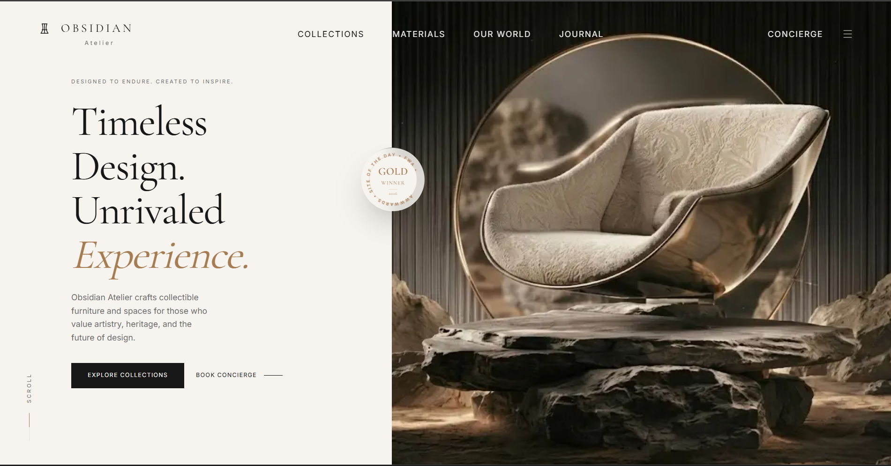
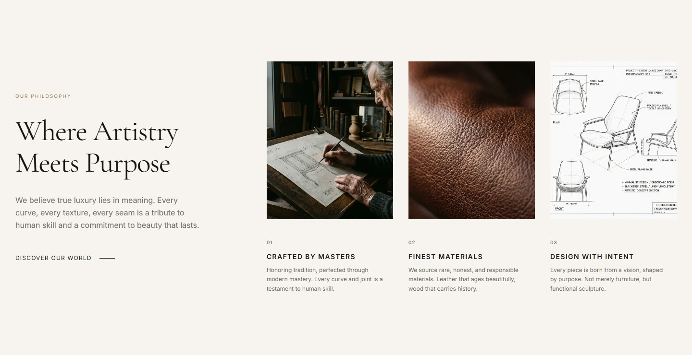
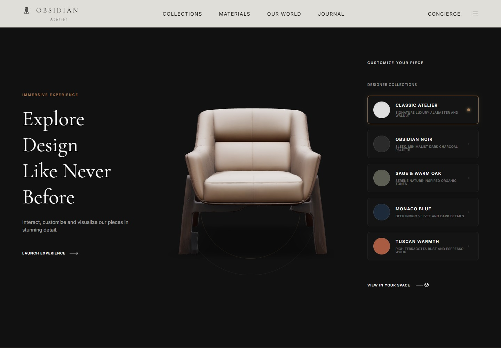
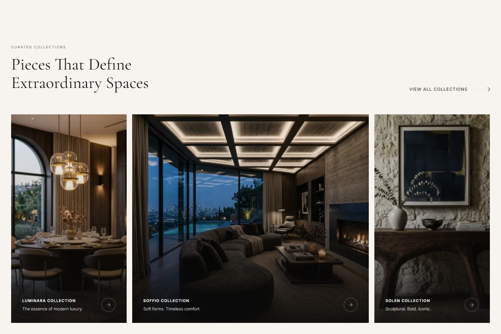
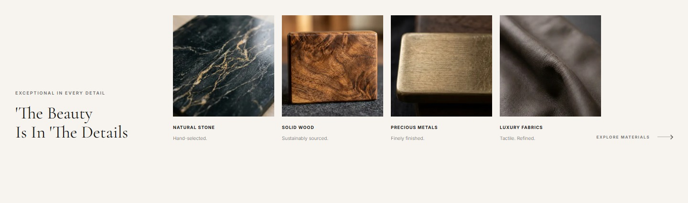
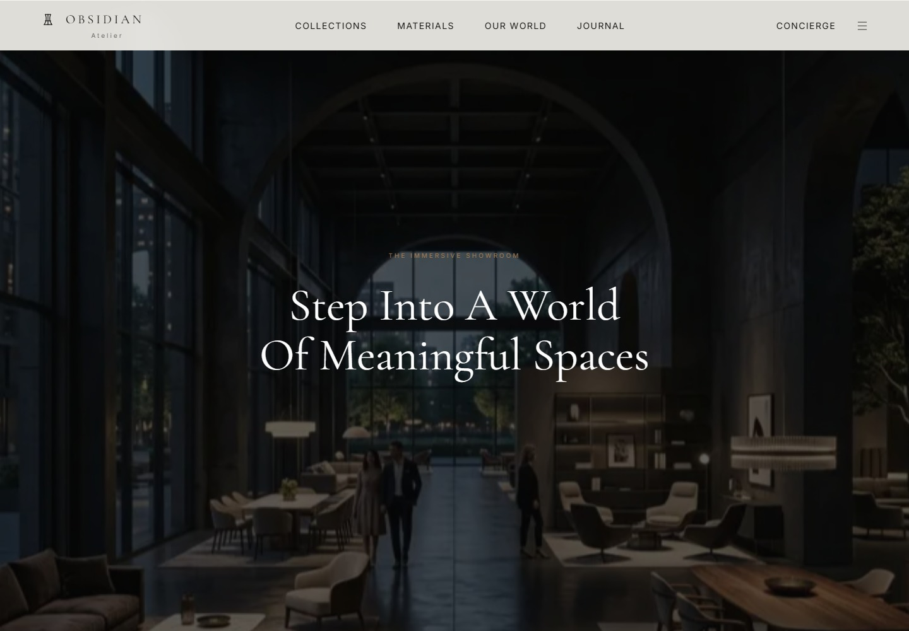

# Obsidian Atelier

A furniture and interiors website concept focused on visual design, art direction, and an immersive browsing experience.

This is a design showcase. Product collections, awards, showroom details, and concierge calls to action are presentation content; booking and checkout services are not connected.

## Preview

### Homepage screenshot



### Our philosophy



### Interactive chair experience



### Curated collections



### Material library



### Immersive showroom



## Design

- Warm ivory, charcoal, and muted gold tones with Cormorant Garamond and Inter typography.
- Large furniture imagery, editorial layouts, and curated collection cards.
- An interactive 3D chair experience with color presets and orbit controls.
- Material explorations, a brand philosophy section, and a showroom presentation.
- Smooth scrolling and motion effects built with Lenis and GSAP.

## Built with

Next.js 16 App Router, React 19, TypeScript, Tailwind CSS 4, Three.js, React Three Fiber, React Three Drei, GSAP, Lenis, and Lucide icons.

## Run locally

Use Node.js 20.9 or newer.

```bash
npm ci
npm run dev
```

Open [localhost:3000](http://localhost:3000). If that port is occupied, use the address printed by the development server.

```bash
npm run build   # Create a production build
npm start       # Serve the production build
npm run lint    # Run ESLint
```

The font setup downloads Google Fonts during development or builds. The 3D experience requires a browser with WebGL support.

## Project structure

```text
src/app/          Page composition, layout, and global styles
src/components/   Website sections and interactive 3D experience
public/images/    Furniture and material imagery
public/models/    3D chair assets
docs/images/      Website screenshots for this README
```
